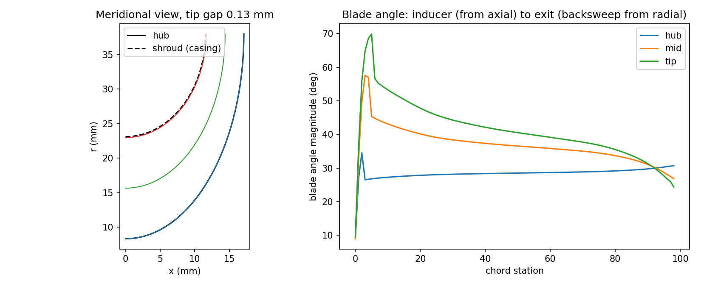
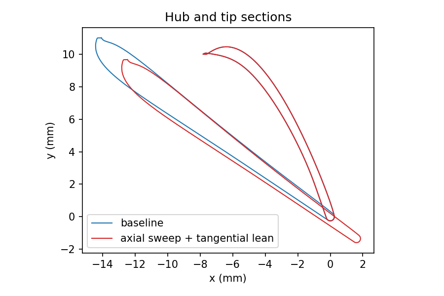
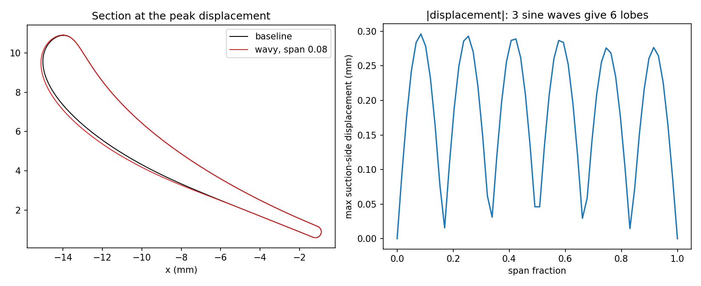

# MicroBladeGen

**Blade and impeller geometry design for micro-turbojets and UAV propulsion.**

MicroBladeGen turns engine-level requirements (mass flow, speed, pressure ratio) into 3D blade geometry for the
parts that matter in a small jet engine: the centrifugal impeller, axial compressor rotors and the turbine nozzle
guide vane. It reports the quantities a small-engine designer checks first (tip Mach number, chord Reynolds number,
solidity, de Haller number, tip-clearance ratio), models tip clearance, and exports CFD-ready geometry.

Status: **alpha (0.1.0)**. It is a conceptual and preliminary design tool. It produces geometry and mean-line
estimates; it does not replace CFD, stress analysis or rig testing.



---

## Why micro-scale needs its own tooling

Large-engine rules of thumb break down below about 1 kg/s:

| Effect | Consequence |
|---|---|
| Short blades (exit heights of 4-6 mm) | A 0.13 mm tip gap is already 2-3 % of the blade height |
| Chord Reynolds numbers of 1e5 to 3e5 | Profile loss rises; laminar separation becomes a design concern |
| Tip speeds of 350-450 m/s at 60-150 krpm | Tip Mach number near or above 1 on small wheels; disk stress and growth matter |
| Few, small blades | Manufacturing tolerance is a large fraction of the geometry |

MicroBladeGen puts these quantities next to the geometry so they can be reviewed in the same step.

---

## Features

**Geometry (2D to 3D)**
- 2D profiles with Bezier thickness, blended leading edge and semicircular trailing edge (`Airfoil2D`)
- 3D axial blades stacked from hub/mid/tip sections with lean and sweep (`Airfoil3D`)
- Wavy-edge blades (`AirfoilWavy`)
- Centrifugal impellers with splitters, built from a meridional contour (`Centrif`)

**Micro-turbojet layer (`microbladegen.micro`)**
- Mean-line centrifugal impeller sizing and a builder that drives `Centrif` with measured-angle refinement
- Axial row metrics: solidity, aspect ratio, thickness-to-chord, blade speed, inlet/exit Mach, tip blade Mach,
  chord Reynolds number, de Haller number, turning (cold air or hot-gas properties)
- Tip-clearance modelling: disk and thermal growth, clearance budget, first-order efficiency and stall-margin effect,
  and a geometric tip gap on built impellers
- Four editable example design cases with realistic micro-turbojet parameters
- Clean summary tables and a CFD-ready export folder with a manifest

---

## Installation

Requires Python 3.10 or newer.

```bash
git clone https://github.com/Pavankreative/microbladegen.git
cd microbladegen
pip install -e .
pip install pytest        # to run the tests
```

Dependencies: numpy, scipy, pandas, matplotlib, plotly, shapely, numpy-stl, tqdm, requests.

---

## Quick start

### Command line

```bash
python -m microbladegen.micro list
python -m microbladegen.micro summary impeller_250g
python -m microbladegen.micro export impeller_250g out/impeller_250g
```

### Python

```python
from microbladegen.micro import (size_impeller, build_impeller, clearance_budget,
                                 build_case, case_summary, export_case)

# 1. Size an impeller from engine requirements
s = size_impeller(mass_flow=0.25, rpm=110000, pressure_ratio=3.2, backsweep=30, beta1s_flow=58)
print(s.r2 * 1e3, s.u2, s.tip_mach, s.inlet_rel_mach_shroud, s.diffusion_ratio, s.notes)

# 2. Pick a cold tip gap and build the 3D blade
gap = clearance_budget(s.r2, s.u2, material="titanium_6al4v").recommended
imp = build_impeller(s, tip_clearance=gap)

# 3. Or work from a bundled case
case = build_case("ngv_micro_turbojet")
print(case_summary(case))
export_case(case, "out/ngv")
```

Bundled cases are JSON files in `microbladegen/micro/cases/`. Copy one and edit it to make your own.

---

## Example design cases

| Case | Component | Operating point |
|---|---|---|
| `impeller_250g` | Centrifugal impeller, 6 + 6 blades | 0.25 kg/s, 110,000 rpm, impeller PR 3.2 (about 150-200 N class engine) |
| `impeller_150g` | Centrifugal impeller, 6 + 6 blades | 0.15 kg/s, 150,000 rpm, impeller PR 3.0 (small drone) |
| `axial_rotor_064krpm` | First-stage axial compressor rotor, 29 blades | 0.6 kg/s core, 64,000 rpm |
| `ngv_micro_turbojet` | Turbine nozzle guide vane, 17 vanes | Tt 1100 K, Pt 290 kPa, 66.5 deg exit swirl, gamma 1.33 |

### Impellers (mean-line sizing, from `size_impeller`)

| Quantity | `impeller_250g` | `impeller_150g` |
|---|---|---|
| Exit radius r2 | 38.0 mm | 28.4 mm |
| Tip speed U2 | 438 m/s | 447 m/s |
| Tip Mach U2 / a01 | 1.29 | 1.31 |
| Shroud relative Mach | 0.95 | 1.00 |
| Diffusion ratio W1s / W2 | 1.81 | 1.68 |
| Inducer shroud / hub radius | 23.1 / 8.3 mm | 17.2 / 6.5 mm |
| Exit blade height b2 | 5.55 mm | 4.45 mm |
| Machine Reynolds rho01 U2 r2 / mu01 | 1.14e6 | 8.7e5 |
| Recommended cold tip gap (titanium) | 0.131 mm | 0.126 mm |
| Gap / b2 | 2.4 % | 2.8 % |

The impeller pressure ratio is total-to-total across the impeller only; diffuser and volute losses reduce the stage ratio.

### Axial rows (measured on the built geometry)

| Quantity | `axial_rotor_064krpm` (hub to tip) | `ngv_micro_turbojet` (hub to tip) |
|---|---|---|
| Radius | 38.7 to 52.3 mm | 28.0 to 38.0 mm |
| Chord | 12.9 to 18.1 mm | 16.5 mm |
| Solidity | 1.54 to 1.61 | 1.60 to 1.18 |
| Thickness / chord | 5.7 to 9.4 % | 14.2 to 14.7 % |
| Blade tip speed Mach | 0.79 to 1.06 | not applicable |
| Inlet Mach (blade frame) | 0.58 to 0.87 | 0.30 |
| Exit Mach (blade frame) | 0.45 to 0.69 | 0.93 to 0.70 |
| Chord Reynolds number | 1.5e5 to 3.3e5 (inlet) | 1.4e5 to 1.2e5 (exit) |
| de Haller number | 0.76 to 0.81 | not applicable (accelerating) |

The free-vortex swirl in the nozzle guide vane makes the hub the highest-Mach section; check it when you change the exit angle.

---

## Metrics reference

| Metric | Definition |
|---|---|
| Tip speed | `2 pi N r_tip / 60` |
| Tip Mach (impeller) | `U2 / a01`, with `a01` the inlet stagnation speed of sound |
| Blade tip Mach (axial) | `U_tip / a1`, `a1` the inlet static speed of sound |
| Relative Mach | `W1 / a1` (rotor) or `C1 / a1` (stator), static speed of sound |
| Chord Reynolds number | `rho W c / mu`, Sutherland viscosity, mean span |
| Machine Reynolds number | `rho01 U2 r2 / mu01` |
| Solidity | chord / pitch, pitch `2 pi r / Z` |
| Aspect ratio | blade height / mean chord |
| de Haller number | `W2 / W1` (rotor), `C2 / C1` (stator); reported only for diffusing rows |
| Diffusion ratio (impeller) | `W1s / W2` |
| Tip-clearance ratio | gap / blade height (axial) or gap / `b2` (impeller) |

Definitions, equations and assumptions are in [`docs/04_metrics_clearance_export.md`](docs/04_metrics_clearance_export.md).

---

## 3D stacking, lean, sweep and wavy blades



Axial blades are stacked from hub, mid and tip sections on their leading edges, centroids or trailing edges.

**Naming caution.** In this library `add_lean(leanX=...)` displaces sections *axially* (usually called sweep) and
`add_sweep(sweep_y=...)` displaces them *tangentially* (usually called lean). Both take fractions of blade height; on the
13.4 mm rotor blade an input of 0.2 is 2.68 mm. Details in [`docs/02_stacking_lean_sweep_wavy.md`](docs/02_stacking_lean_sweep_wavy.md).



Wavy blades act mainly on the suction-side shape. For the bundled vane a suction-side ratio of 0.03 moves the surface by
0.085 mm, linearly in the ratio. Measure the realised displacement before committing to a wave amplitude.

---

## Centrifugal impeller design

`size_impeller` follows a standard mean-line procedure: work from the pressure ratio and efficiency, Wiesner slip, blade
count from a Glassman heuristic, tip speed from the Euler work with disk friction, exit width from continuity, and the
inducer radius from continuity at a chosen shroud flow angle. It then reports diffusion ratio, specific speed, Reynolds
number and advisory notes (tip Mach, shroud Mach, diffusion limit, exit height, tip speed).

`build_impeller` turns the sizing into a 3D blade through the upstream `Centrif` generator, using the non-ray camber mode
(both end angles honoured, same sign so the blade does not S-curve), converting thickness from metres, and refining the
inputs until the measured blade angles match the sizing (within about 1 degree for the bundled case). The full procedure and
the upstream behaviour that shaped it are in [`docs/03_centrifugal_impeller.md`](docs/03_centrifugal_impeller.md).

---

## Tip clearance

For a titanium wheel at `r2 = 38 mm` and `U2 = 438 m/s` the clearance budget is:

| Term | Value |
|---|---|
| Disk rim growth, `(1 - nu) rho U^2 r / (4 E)` | 0.047 mm |
| Differential thermal growth (rotor +60 K, casing +20 K) | 0.013 mm |
| Machining, runout, out-of-round | 0.05, 0.03, 0.03 mm |
| **Recommended cold gap** (RSS plus margin) | **0.131 mm** |

That gap is 2.4 % of the 5.5 mm exit height. `clearance_effect` converts the ratio into a first-order penalty (about 3.6
efficiency points and 9.5 stall-margin points for this case). The penalty coefficients are generic literature-range values:
they give the trend, not a prediction, and should be calibrated against hardware data.

The upstream `Centrif.tip_clearance` setting reparameterises the span variable but does not move the blade tip, so the
micro builder applies the gap geometrically and verifies it (the tip ends exactly the gap below the casing along the
hub-to-shroud line).

---

## CFD-ready export

```bash
python -m microbladegen.micro export impeller_250g out/impeller_250g
```

```
out/impeller_250g/
  manifest.json                  units, rpm, blade counts, periodic sector angle, radii, tip clearance, flow conditions
  sections/main_section_*.txt    x y z in metres, one file per span (SS then PS), machine axis along x
  sections/splitter_section_*.txt
  main_blade_surface.stl         suction- and pressure-side patches
  splitter_blade_surface.stl
  hub_curve.csv, shroud_curve.csv   meridional (x, r) flow-path contours
  summary_flow.csv, summary_sections.csv
```

Axial rows are wrapped onto their cylinders before export. The STL files are open shells (suction and pressure side), and
the export contains geometry only, with no boundary conditions. It has not been tested against a specific mesher; close the
leading edge, trailing edge and tip in your CAD or meshing tool.

---

## Documentation

| Document | Contents |
|---|---|
| [`docs/01_airfoil_2d.md`](docs/01_airfoil_2d.md) | 2D profile inputs, what the thickness arrays mean, micro-scale guidance |
| [`docs/02_stacking_lean_sweep_wavy.md`](docs/02_stacking_lean_sweep_wavy.md) | Coordinates, stacking, measured lean/sweep conventions, wavy blades |
| [`docs/03_centrifugal_impeller.md`](docs/03_centrifugal_impeller.md) | Sizing equations, builder conventions, tip gap, limitations |
| [`docs/04_metrics_clearance_export.md`](docs/04_metrics_clearance_export.md) | Metric definitions, clearance model, export format |

Runnable examples are in `examples/` (`01_micro_impeller.py`, `02_axial_rotor_lean_sweep.py`, `03_wavy_ngv.py`).

---

## Project layout

```
microbladegen/
  aero/        Airfoil2D, Airfoil3D, AirfoilWavy, Centrif, Passage2D, ...
  helper/      Bezier curves, stacking, geometry utilities
  ml/          one experimental upstream utility (not used by the micro layer)
  micro/       impeller sizing/build, metrics, tip clearance, cases, summary, CFD export
    cases/     editable example design cases (JSON)
docs/          engineering documentation
examples/      runnable scripts
tests/         upstream tests plus tests/micro
tutorials/     upstream notebooks and scripts (import names updated)
```

---

## Testing

```bash
pytest
```

The suite contains the 16 upstream geometry tests and 45 tests for the micro layer: continuity and Euler-work closure of
the sizing, measured blade angles and tip gap of the built impeller, closed-form disk growth, metric definitions, case
builds, wavy-blade linearity, and export contents (section radii, STL bounds, periodic sector angle).

---

## Limitations and validation status

- The sizing, metrics and clearance models are mean-line and first-order. They have **not** been validated against test
  data; they are checked for internal consistency (closure of continuity and work equations, analytic cases).
- The clearance penalty coefficients and the recommended-gap margins are generic defaults.
- Axial rows use a single free-vortex swirl distribution and set metal angle equal to flow angle; apply incidence and
  deviation before treating the angles as final metal angles.
- No stress, modal, thermal or aerodynamic loss analysis is included.
- Upstream tutorials and notebooks are kept as provided with import names updated; they have not been re-run as part of this project.

---

## Origin and licensing

MicroBladeGen is a Modification of PyTurbo-Aero, Original Software released by NASA (Glenn Research Center), and is
distributed under the NASA Open Source Agreement 1.3: see [`LICENSE`](LICENSE), [`NOTICE.md`](NOTICE.md) and
[`CHANGES.md`](CHANGES.md). It is not affiliated with or endorsed by NASA.

> MicroBladeGen is a Modification of [PyTurbo-Aero](https://github.com/nasa/pyturbo-aero) (NASA Glenn Research Center), used under the NASA Open Source Agreement 1.3.
